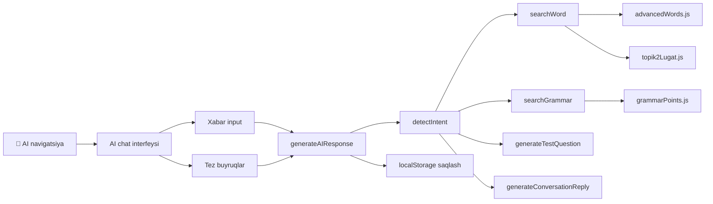

# Requirements

### Overview
Chat bo'limiga **AI Koreys o'qituvchisi** qo'shiladi — mahalliy (offline) AI, internet talab qilmaydi, bepul. Foydalanuvchi koreys tilini o'rganishda yordam beradigan AI bilan suhbatlasha oladi.

### Scope
**In Scope:**
- AI chat alohida navigatsiya tugmasida (🤖 AI)
- 4 ta qobiliyat: tarjima, grammatika yordami, suhbat mashqi, test savollari
- Mahalliy AI — oldindan yozilgan bilim bazasi (455+ so'z, 100+ grammatika)
- Chat tarixi localStorage'da saqlanadi
- Liquid Glass stil va animatsiyalar

**Out of Scope:**
- Bulutli AI (API talab qiladigan)
- Ovozli AI chat
- AI orqali yangi so'zlar qo'shish

### User Stories
1. As a foydalanuvchi, I want AI bilan koreys tilida suhbatlashish, so that tilimni mashq qilaman.
2. As a foydalanuvchi, I want koreys so'z yoki gap tarjimasini so'rash, so that tez tarjima olaman.
3. As a foydalanuvchi, I want grammatika haqida so'rash, so that qoidalarni tushunaman.
4. As a foydalanuvchi, I want test savollari so'rash, so that bilimimni tekshiraman.

### Functional Requirements
- **Tarjima**: Koreys so'z yoki gap yozilsa, o'zbek tiliga tarjima + misol gap
- **Grammatika**: Grammatika qoidasi haqida so'ralsa, tushuntirish + misol
- **Suhbat mashqi**: Oddiy koreys gaplariga AI koreys tilida javob beradi, o'zbek tilida ham tushuntiradi
- **Test savollari**: AI tasodifiy test savoli beradi, javob tekshiradi
- **Tez buyruqlar**: 📖 Tarjima, 📝 Grammatika, 💬 Suhbat, 🧠 Test tugmalari
- **Chat tarixi**: localStorage'da saqlanadi, sahifa yangilanganda qayta yuklanadi
- **Tozalash**: Chat tarixini tozalash tugmasi

# Technical Design

### Current Implementation
- **App.jsx** (3078 qator): Barcha logika bitta faylda. Chat bo'limi mavjud (2657-2779 qator) — foydalanuvchilar o'rtasidagi suhbat.
- **grammarPoints.js**: 100 ta grammatika qoidasi (pattern, explanation, example, translation)
- **advancedWords.js**: 100 ta TOPIK II so'z (korean, meaning, example, category)
- **topik2Lugat.js**: 255 ta TOPIK II lug'at so'zi
- Navigatsiya: TOPIK I, TOPIK II, 💬 Chat, 👤 Profil (4 ta tugma)

### Key Decisions
- **Mahalliy AI**: Oldindan yozilgan bilim bazasi + kalit so'zlar orqali javob generatsiya. Internet talab qilmaydi, bepul.
- **AI logic**: `aiChat.js` alohida faylda — katta faylga qo'shmaslik uchun.
- **Javob tizimi**: Kalit so'zlar + regex + tasodifiy javoblar kombinatsiyasi.
- **Chat saqlash**: `topik-play-ai-chat` localStorage key orqali.

### Proposed Changes

#### 1. `src/aiChat.js` yaratish
AI logikasi alohida fayl:
- `generateAIResponse(message, chatHistory)` — asosiy funksiya
- `detectIntent(message)` — niyat aniqlash (tarjima, grammatika, suhbat, test)
- `searchWord(korean)` — so'z qidirish (advancedWords + topik2Lugat)
- `searchGrammar(pattern)` — grammatika qidirish
- `generateTestQuestion()` — test savoli generatsiya
- `generateConversationReply(message)` — suhbat javobi

#### 2. `App.jsx` yangilanishlari
- **Yangi state'lar**: `aiMessages`, `aiInput`, `aiChatHistory` (localStorage)
- **Yangi navigatsiya**: 🤖 AI tugmasi qo'shiladi (5 ta: TOPIK I, TOPIK II, 💬 Chat, 🤖 AI, 👤 Profil)
- **AI chat interfeysi**: Mavjud chat interfeysiga o'xshash, lekin AI uchun moslashtirilgan
- **Tez buyruqlar**: 4 ta tugma (📖 Tarjima, 📝 Grammatika, 💬 Suhbat, 🧠 Test)
- **handleSendAIMessage()**: Xabar yuborish + AI javob generatsiya

#### 3. `App.css` yangilanishlari
- AI chat uchun yangi stillar (mavjud chat stillariga o'xshash)
- Tez buyruqlar tugmalari
- AI avatar va badge
- Test savollari interfeysi

### File Structure
```
src/
├── App.jsx (modified) — AI state, navigatsiya, AI chat interfeysi
├── App.css (modified) — AI chat stillari
├── aiChat.js (new) — AI logikasi
├── grammarPoints.js (used) — grammatika bazasi
├── advancedWords.js (used) — so'zlar bazasi
└── topik2Lugat.js (used) — TOPIK II lug'at
```

### Architecture Diagram


### Risks
- **Javob sifat**: Mahalliy AI cheklangan bilim bazasiga ega. Noma'lum so'zlar uchun "bilmayman" javobi qaytariladi.
- **Performance**: 455+ so'z va 100+ grammatika qidirish tez bo'lishi kerak — har bir so'rovda to'liq array filter qilinadi.
- **Chat tarixi hajmi**: localStorage chegarasi (~5MB) — 1000 dan ortiq xabar saqlansa, eski xabarlar o'chiriladi.

# Delivery Steps

### ✓ Step 1: 1. aiChat.js AI logikasi yaratish
AI chat logikasi alohida faylda yaratiladi — generateAIResponse, detectIntent, searchWord, searchGrammar, generateTestQuestion, generateConversationReply funksiyalari.
- `src/aiChat.js` fayli yaratiladi
- `generateAIResponse(message)` — asosiy funksiya: niyat aniqlash + javob generatsiya
- `detectIntent(message)` — kalit so'zlar orqali: tarjima (tarjima, nima degani, ma'no), grammatika (grammatika, qoida, qanday), test (test, savol, tekshir), suhbat (boshqa hamma)
- `searchWord(korean)` — advancedWords + topik2Lugat da so'z qidirish (korean yoki meaning da)
- `searchGrammar(pattern)` — grammarPoints da pattern, title yoki explanation da qidirish
- `generateTestQuestion()` — tasodifiy so'z/grammatika tanlab, 4 variantli test yaratish
- `generateConversationReply(message)` — oddiy koreys gaplariga javoblar (salom, qalaysiz, rahmat va h.k.)
- Export: `generateAIResponse` funksiyasi

### ✓ Step 2: 2. App.jsx ga AI chat integratsiya qilish
AI chat interfeysi, state'lar, navigatsiya va tez buyruqlar qo'shiladi.
- `App.jsx` ga `aiChat.js` import qilinadi
- Yangi state'lar: `aiMessages` (xabarlar ro'yxati), `aiInput` (input), `aiChatMode` (tez buyruq rejimi)
- `useEffect` — localStorage'dan AI chat tarixini yuklash (`topik-play-ai-chat`)
- `handleSendAIMessage()` — xabar yuborish + AI javob generatsiya + localStorage ga saqlash
- Navigatsiyaga 🤖 AI tugmasi qo'shiladi (5 ta tugma: TOPIK I, TOPIK II, 💬 Chat, 🤖 AI, 👤 Profil)
- AI chat interfeysi: chat-header (← Orqaga, 🤖 AI Koreys o'qituvchisi), tez buyruqlar (4 ta tugma), xabarlar container, input
- Tez buyruqlar: 📖 Tarjima, 📝 Grammatika, 💬 Suhbat, 🧠 Test
- Chat tozalash tugmasi (🗑️)
- AI xabarlar localStorage'da saqlanadi, sahifa yangilanganda qayta yuklanadi

### ✓ Step 3: 3. App.css ga AI chat stillari qo'shish
AI chat interfeysi uchun Liquid Glass stil va animatsiyalar qo'shiladi.
- `.ai-chat-panel` — asosiy panel (mavjud chat-panel ga o'xshash)
- `.ai-quick-actions` — tez buyruqlar grid (4 ta tugma, glassmorphism)
- `.ai-bubble` — AI xabar bubble (o'ngda, gradient background)
- `.user-bubble` — foydalanuvchi xabar bubble (chapda, oddiy background)
- `.ai-test-question` — test savoli kartochkasi (glassmorphism, 4 variant tugmasi)
- `.ai-test-correct` / `.ai-test-wrong` — to'g'ri/xato javob ranglari
- `.ai-welcome` — boshlang'ich xabar (AI salomlashuv + qanday yordam berishi mumkinligi)
- Responsive dizayn: 768px va 480px breakpoint'lar
- Animatsiyalar: fadeInUp, slideIn (mavjud keyframe'lardan foydalanish)